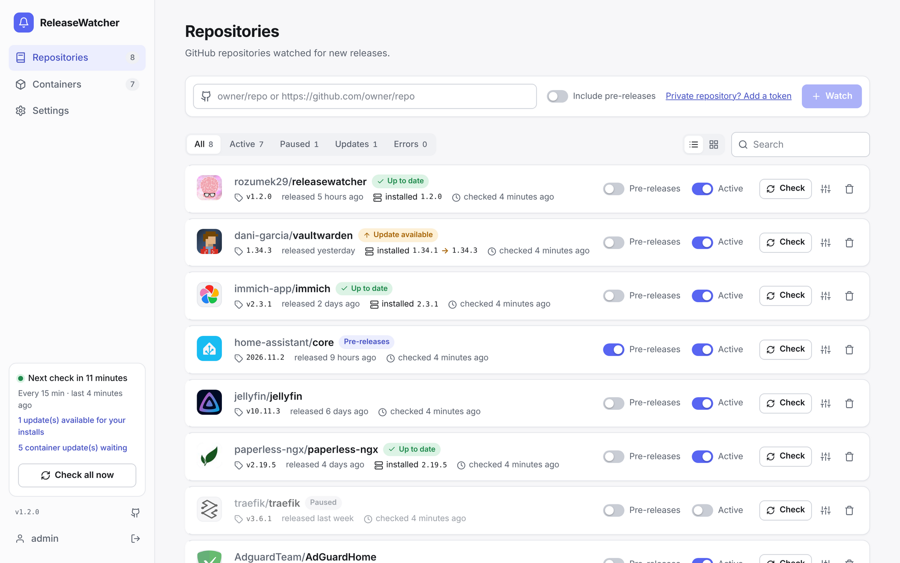
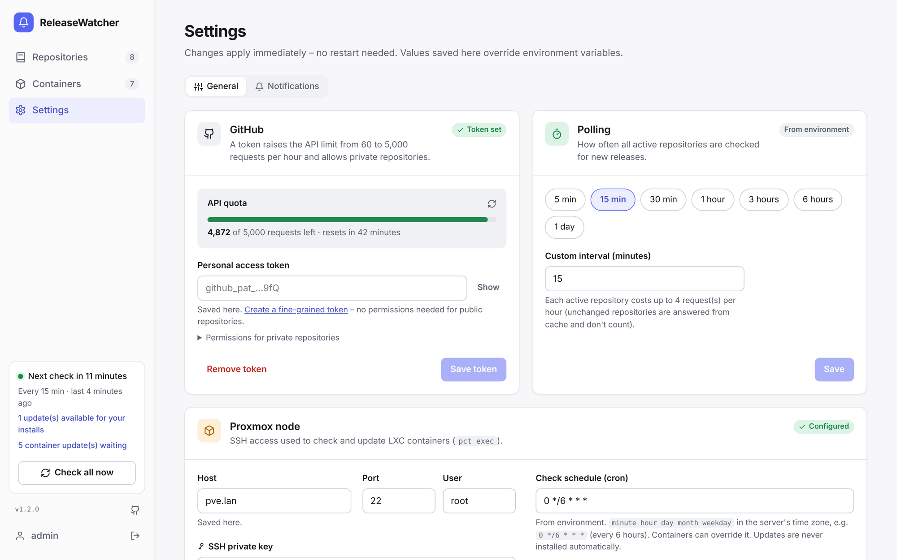
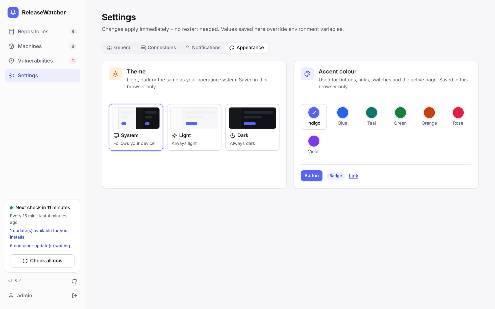

<div align="center">


# ReleaseWatcher

**Self-hosted release tracker for your homelab.**<br>
Get notified about new GitHub releases and keep your Proxmox LXC containers up to date – from one small app.

[](#releases)
[](https://bun.sh)
[](https://angular.dev)
[](#docker)
[](#machines-proxmox-guests-and-servers)

[Features](#features) · [Quick start](#quick-start) · [Installation](#installation) · [Configuration](#configuration) ·
[API](#api) · [Development](#development)

<br>

<picture>
  <source media="(prefers-color-scheme: dark)" srcset="docs/images/repositories-dark.png">
  
</picture>

</div>

---

## Features

**GitHub releases**

- Watch any public or private repository (`owner/repo` or a GitHub URL); pre-releases are opt-in per repository.
- Notifications on **Discord** (webhook) and by **e-mail** (built-in SMTP client) – one message per release or one
  summary per check run.
- **Installed version** of your self-hosted instance (e.g. Vaultwarden's `/api/version`) – or entered by hand for
  apps without one: see *Update available 1.34.1 → 1.34.3* at a glance, and skip releases you already run.
- **Vulnerabilities** of every watched repository from GitHub security advisories and **OSV.dev** (sources switchable
  in Settings): a *Vulnerabilities* page shows which ones affect your installed version, and new ones are notified.
- **Custom icons** per repository – an image URL or a [selfh.st/icons](https://selfh.st/icons/) name like
  `sh:frigate` – instead of the owner's avatar, also shown next to linked applications on the Machines page.
- Rate-limit friendly: conditional requests with ETags, optional token (global or per repository).

**Proxmox LXC containers**

- Pending **apt** packages and **application** versions of every container, virtual machine (through the QEMU guest
  agent) and of the Proxmox host on a cron schedule, over a single SSH connection – guests need no SSH server.
- **Restart needed** hints (new kernel, `reboot-required`, processes using upgraded libraries) with a one-click
  restart.
- **Home Assistant OS** in a virtual machine is found automatically: updates of Core, the OS, the Supervisor, apps
  and integrations (e.g. from the built-in marketplace) – with or without a Home Assistant access token.
- One-click updates: apt upgrades, community-scripts `update`, or your own scripts, with live console output and
  run history. **Updates never run automatically.**
- Optional **`vzdump` backup** before every update, **temporary CPU/RAM boost** for heavy updates, temporary start
  of stopped containers.
- Updates run as transient systemd units on the node, so they survive a dropped connection or a restart of
  ReleaseWatcher.
- **Detect applications** inside a container (community-scripts and well-known apps) and link them to their GitHub
  repository.

**App**

- A single self-contained executable (Bun runtime + UI) or a Docker image; one SQLite file, no external services.
- Login with password and/or **passkeys**; **API tokens** (read-only or full) for dashboards like Homepage; secrets encrypted at rest (AES-256-GCM).
- Clean, responsive UI with light and dark themes (follow the system or pick one) and accent colour presets
  (*Settings → Appearance*, saved per browser); every setting can be changed in the UI without a restart.

<table>
  <tr>
    <td width="50%">
      <picture>
        <source media="(prefers-color-scheme: dark)" srcset="docs/images/containers-dark.png">
        
      </picture>
      <p align="center"><sub>Machines – pending apt packages and application updates</sub></p>
    </td>
    <td width="50%">
      <picture>
        <source media="(prefers-color-scheme: dark)" srcset="docs/images/settings-dark.png">
        
      </picture>
      <p align="center"><sub>Settings – applied immediately, no restart</sub></p>
    </td>
  </tr>
  <tr>
    <td colspan="2" align="center">
      <picture>
        <source media="(prefers-color-scheme: dark)" srcset="docs/images/appearance-dark.png">
        
      </picture>
      <p align="center"><sub>Appearance – light, dark or system theme and an accent colour</sub></p>
    </td>
  </tr>
</table>

## Quick start

```bash
docker run -d --name releasewatcher --restart unless-stopped \
  -p 8080:8080 -v releasewatcher-data:/data \
  ghcr.io/rozumek29/releasewatcher:latest

docker logs releasewatcher 2>&1 | grep setupCode    # one-time code to create your account
```

Open <http://localhost:8080>, create the account with the setup code, then:

1. **Settings → Notifications** – add a Discord webhook and/or SMTP server and send a test message.
2. **Settings → General** – add a GitHub token (recommended); for containers add an SSH key and your Proxmox node
   under **Settings → Connections**.
3. **Repositories** – add the repositories you want to watch.
4. **Machines** – add the containers of your Proxmox node(s) and your servers to watch their apt packages and
   applications.

> [!NOTE]
> If the image is private, log in first with `docker login ghcr.io` (a GitHub token with `read:packages`).

## How it works

### Release notifications

1. You add a repository in the UI or via the API. A new database already watches ReleaseWatcher itself
   (`rozumek29/releasewatcher`, stable releases only, with its own `/api/version` as the installed-version URL), so
   the UI tells you when an update is available. Remove it like any other repository – it is not added again.
2. The first check only stores a **baseline** (the newest existing release), so you are not spammed with history.
3. On the `RELEASE_CHECK_CRON` schedule (default `*/15 * * * *` – every 15 minutes, server time zone) and once shortly
   after a start, the poller fetches recent releases using conditional requests (`If-None-Match` / ETag – a `304`
   does not count against GitHub's rate limit).
4. Releases newer than the baseline are sent to every enabled notifier (oldest first, max 5 per check), then the
   baseline moves forward. Drafts are ignored; pre-releases are opt-in per repository.
5. **Settings → Notifications** chooses what is sent (new releases, new vulnerabilities, application updates, apt updates, finished and
   failed updates) and whether one check run sends **one summary** (digest) instead of one message per item. The
   summary is sent when a run of all repositories or of the scheduled containers ends; checking a single repository
   or container still notifies right away. Held-back items are lost if the process stops before the run ends (they
   are never sent twice).

**Installed version** (repository settings, sliders icon): an optional URL of your self-hosted instance, e.g.
`https://vault.lan/api/version`. It is read on every check – plain text, a JSON string, common keys like `version`,
or an explicit JSON path such as `data.version` – and **Test URL** previews the result. Optional request headers
(`Authorization: Bearer …`, `X-Api-Key`) are stored encrypted and never returned by the API. Releases you already
run (installed ≥ release) are not announced, and Discord messages include the installed version.

Apps without such an endpoint (desktop apps, firmware, external services) can take the installed version **by hand**:
choose *Installed version from → Entered by hand* and type it (e.g. `1.34.1`). It is used like a version read from a
URL – update badge, skipped notifications, vulnerability impact – and kept until you change it. After upgrading,
**Mark as installed** on the repository sets it to the latest release in one click.

**Icon** (repository settings): by default a repository shows the avatar of its owner – for apps published under a
personal account that is the developer's photo, not the app's logo. Enter an image URL (`https://…/logo.svg`) or an
icon name from [selfh.st/icons](https://selfh.st/icons/) with the `sh:` prefix, as in Homepage or Homarr: `sh:frigate`,
`sh:frigate-light`, `sh:frigate-dark` – or click **Browse** to pick one visually: a searchable grid of all selfh.st
icons with their light and dark variants (the list is loaded by your browser from jsDelivr). It resolves to the jsDelivr CDN
(`https://cdn.jsdelivr.net/gh/selfhst/icons/svg/<name>.svg`, then the PNG and WebP versions); `sh:<name>.png` picks a
format. When the icon can't be loaded, the owner's avatar is shown. Applications on the Machines page that take their
latest version from the repository show its icon too. Discord notifications use it as the author icon – as PNG,
since Discord shows no SVG (an SVG URL falls back to the owner's avatar there).

### Vulnerabilities

Known vulnerabilities are read on their own schedule, `ADVISORY_CHECK_CRON` (default `0 */6 * * *` – every 6 hours),
and on the first check of a new repository; a manual **Check** always reads them. Runs missed while the app was stopped
are caught up shortly after a start. All schedules (releases, vulnerabilities, containers) are cron expressions and can
be changed under **Settings → General → Check schedules**. Runs that fall into the same minute are chained in this
order – releases, then vulnerabilities, then containers – each starting when the previous one has finished, and in
digest mode they send one summary together. **Settings → General → Vulnerability sources** switches each source on or off:

| Source | What it reads | Setup |
| --- | --- | --- |
| **GitHub security advisories** | the GHSA entries maintainers publish under *Security → Advisories* (`GET /repos/{owner}/{repo}/security-advisories`, with ETags and the same token as the releases) | none |
| **OSV.dev** | the [OSV](https://osv.dev) database (GitHub, Go, PyPI, RustSec, … with CVE aliases) for the package the app is published as (`POST https://api.osv.dev/v1/query`) | repository settings → *Vulnerabilities from OSV.dev*: ecosystem + package, e.g. `npm` / `n8n` or `Go` / `github.com/gitea/gitea` |

- Vulnerabilities reported by both sources (same GHSA/CVE id) are listed once. Withdrawn ones are dropped; switching a
  source off removes its entries.
- The vulnerable range (e.g. `>= 1.0.0, < 1.32.1`) is compared with the **installed versions**: the one read from the
  repository's installed-version URL (or entered by hand) plus those of every container app linked to the
  repository (*latest version from* a watched GitHub repository). A vulnerability affects the installation when any of
  these versions is in range; without any version its impact is shown as *Installed version unknown*. A range without
  an upper bound (e.g. `>= 0.104.0`) is capped by the patched version (`0.135.0` → `>= 0.104.0, < 0.135.0`), so newer
  versions are not flagged. Other notations used in advisories are understood too: `>= 2.0.0 && <= 2.1.3`,
  `1.23.0 - 1.23.15`, lists of versions (`2.0.0-beta.0, 2.0.0-beta.1`) and `*` (all versions). The **Vulnerabilities**
  page lists all of them – affecting the installed version first – with severity, CVSS score, ids, vulnerable and
  patched versions, filters (impact, severity, source) and search. It opens on *Affects installed* (or *All* when
  nothing affects an installed version); the sidebar counts those affecting an installed
  version. Each repository also shows a badge (red *N vulnerabilities affect installed* / grey *N advisories*) that
  opens its list, and the *Vulnerable* filter tab.
- As with releases, the first read of each source (and of a newly set OSV.dev package) only stores a baseline.
  Vulnerabilities published later are sent to the notifiers (*New vulnerabilities*, max 5 per check) unless the
  installed version is known not to be affected.
- A failed read is shown on the repository (per source) and never marks the release check as failed.

### Machines: Proxmox guests and servers

The **Machines** page lists everything watched over SSH – guests of one or more Proxmox nodes, the nodes themselves
and servers – grouped by host when there is more than one (the old `/containers` address redirects there).

<details>
<summary><b>Connecting the node</b></summary>

Connections live in **Settings → Connections**:

- **SSH keys** – named private keys, shared by any number of hosts (one key for every machine, or one per machine).
  **Generate key** creates an Ed25519 key pair on the server and shows its public key to copy into
  `~/.ssh/authorized_keys`; **Add key** pastes an existing private key. Private keys are encrypted at rest and never
  returned; keys with a passphrase are not supported. A key used by a host cannot be removed.
- **Hosts** – **Add host** opens one dialog for both kinds: pick *Server* or *Proxmox node* (as many nodes as you
  have), then its address, port, SSH user (`root`, or a user allowed
  to run `pct`/`qm` through passwordless `sudo`) and one of the keys; each node has its own backup storage
  (**Edit** → *Backup storage*; none = no backups before updates of its guests). The Machines page picks the node to add guests from. **Test connection** runs `pveversion` on it. A host key is trusted
  on the first connection and pinned in `known_hosts` next to the database; **Forget host key** removes the pinned key
  after the machine was reinstalled.

Only public-key authentication is used (no passwords, no agent). A Proxmox node configured by an older version (in
Settings or through `PROXMOX_*` variables) is moved into a host with a key named *Proxmox node* on the first start.

Tip: restrict the key on the node to ReleaseWatcher's IP (`from="<ip>"` in `authorized_keys`) and use a key
dedicated to it.

</details>

<details>
<summary><b>Servers (VPS and other Linux machines)</b></summary>

A server is any Debian/Ubuntu machine reachable over SSH – no Proxmox needed. **Add server** (Machines page) or
**Add host** → *Server* (Settings → Connections) takes its address, port, user and SSH key; it is watched right away:

- Commands run directly on the server (`sh -lc` over SSH; a user other than `root` needs passwordless `sudo`).
- apt is checked with `apt list --upgradable` and upgraded with `apt-get upgrade` (not `dist-upgrade`), without a
  backup. Applications work like in containers (version, latest version, update command, detection).
- **Restart server** schedules `systemctl reboot`, waits until the server answers over SSH again and checks it. It
  waits for running checks and updates of that server first.
- Removing the server on the Machines page also removes its host (and the other way round); its SSH key stays.

</details>

<details>
<summary><b>Containers, checks and applications</b></summary>

- **Add containers** found on the node (`pct list`) one by one or with **Add all**. Commands run inside a container
  with `pct exec <vmid> -- sh -lc '…'`.
- **Virtual machines** (`qm list`) are added one by one (not by *Add all*). Commands run through the QEMU guest agent
  with `qm guest exec <vmid> -- sh -c '…'`, so the VM needs `qemu-guest-agent` installed and **QEMU Guest Agent**
  enabled in its Proxmox options – no SSH server. Checks, apt upgrades, applications, backups, temporary starts
  (`qm start`, waiting up to 3 minutes for the agent) and restarts work like for containers; the output of an
  update appears when it has finished (the agent returns it at the end), and VMs are not resized for updates.
  Appliances without apt can be added with apt switched off.
- **Home Assistant OS** is found by every check of a virtual machine (`ID=haos` in `/etc/os-release`); apt is then
  switched off. Core, the operating system, the Supervisor and apps (add-ons) are read live with the `ha` CLI on the
  HAOS host. Updates of integrations (update entities, e.g. from the built-in marketplace, formerly HACS) are read in
  one of two ways:
  - **without a token** from `core.restore_state`, which Home Assistant saves every 15 minutes (the UI shows its age);
  - **with a long-lived access token** and the Home Assistant URL (VM settings) live from the REST API
    (`GET /api/states`). The token is stored encrypted and sent only from ReleaseWatcher to that URL – never to the
    Proxmox node.

  By default updates are **only checked and reported** (install them in Home Assistant). With *Install Home Assistant
  updates from ReleaseWatcher* switched on in the VM settings, Core, the Supervisor and apps are installed with
  `ha core update` / `ha supervisor update` / `ha apps update <slug>`; integrations need the token (`update.install`
  through the API), and Core is restarted afterwards for custom integrations. The operating system update restarts
  the VM and is always left to Home Assistant itself. Home Assistant tokens cannot be limited to reading – create the
  token for a user without administrator rights to keep it small.
- **Add host** adds the Proxmox node itself (apt only): it is checked like a container and upgraded with
  `apt-get dist-upgrade` (followed by `apt-get autoremove`), as Proxmox VE requires. There is no backup before host upgrades and the host is never
  rebooted automatically – see *Restart needed* below.
- **apt check:** `apt-get update` + `apt list --upgradable`; upgrade = `apt-get -y upgrade` + `apt-get -y autoremove`, keeping existing
  config files.
- **Applications** per container:
  - *version command* – prints the installed version, e.g. `cat /opt/vaultwarden_version.txt`; without one the
    installed version can be entered by hand, and **Mark as installed** sets it to the latest version,
  - *latest version* – the newest release of a watched GitHub repository, a command, or none,
  - *update command* – e.g. `update` (community-scripts) or `cd /opt/app && ./pull.sh`. Enable **TTY** for scripts
    that need a terminal. Update commands run with `PHS_SILENT=1` and `DEBIAN_FRONTEND=noninteractive`, so
    community-scripts' `update` skips its menu. Every update has a timeout (default 30 min).
- **Detect applications** (container settings) looks inside a running container: a community-scripts container
  (`/usr/bin/update` → `ct/<app>.sh`) with its version file, or `/opt/*_version.txt` and version files of well-known
  applications. The GitHub repository comes from a built-in list or from the `# Source:` line of the
  community-scripts script. Nothing is saved until you click **Add**.
- **Schedule:** checks run on `CONTAINER_CHECK_CRON` (default every 6 hours, server time zone – set `TZ`); each
  container can override it. A check is one SSH connection (`pct status` + one `pct exec` with the apt check and all
  version commands); up to `CONTAINER_CHECK_CONCURRENCY` containers are checked in parallel. Each pending item is
  notified once.
- **Restart needed:** every check also looks for `/var/run/reboot-required` (with the packages that asked for it)
  and – in containers and VMs – for processes still using executables or libraries that an upgrade replaced (like
  `needrestart`); on the host and in VMs it compares the running kernel with the newest one in `/boot`. The reasons are shown
  with a **Restart** button (after a confirmation): a container or VM is restarted with `pct reboot` / `qm reboot` (detached, so it
  also works for the container ReleaseWatcher runs in) and checked again; for the host a reboot is scheduled 15 s
  later with `systemd-run` and refused while other checks or updates run. Restarts never happen automatically.
- **Operating system:** every check also reads `/etc/os-release` (plus the Debian point release from
  `/etc/debian_version` and, on the host, `pveversion`) and shows it next to the target, e.g. *Debian 12.8 (bookworm)*
  or *Proxmox VE 9.1.1 · Debian 13.2 (trixie)*. It is informational only – release upgrades are not detected or run.
- **Stopped containers** are not started by default: a check only reads their status and keeps the last results;
  updates are refused. Enable **Start temporarily when stopped** to have checks and updates start the container
  (`pct start`), wait for its network and shut it down afterwards.

</details>

<details>
<summary><b>Updates, backups and resources</b></summary>

- **Updates are manual only.** The console output is shown live and kept in the run history (all runs by
  default; *Settings → Containers* can limit the checks and the other runs – updates, upgrades, restarts – kept per
  container separately; output of finished runs is stored compressed). Only one task runs in a container at a time.
- **Update** (Machines page) first shows checkboxes in the list, with every container that has pending updates
  ticked; a second click updates the ticked containers one after another: apt
  first, then applications. The Proxmox host and stopped containers that may not be started are left out; a failed
  update skips the rest of that container. A container with several pending updates has its own **Update all (n)**.
- **Backups before updates:** choose the backup storage of each node (e.g. Proxmox Backup Server or `local`, in
  Settings → Connections → node → Edit) and a default in Settings → Containers; containers can override it and every confirmation has a **Backup first** checkbox. The backup is a
  `vzdump` in snapshot mode (zstd, except on PBS); retention follows the storage's prune settings; a failed backup
  stops the update.
- **Resilient runs:** backups, upgrades and updates run on the node as transient systemd units
  (`releasewatcher-run-<run>-<step>`, output in `/var/tmp/releasewatcher/`). A dropped connection is re-established
  and the output re-read; after a restart ReleaseWatcher re-attaches and finishes the run.
- **Resources during updates:** a container can get more CPU cores and memory for its updates (e.g. one that
  compiles Rust). They are raised with `pct set` right before the update and restored afterwards – also on failure
  or after a restart.

> [!WARNING]
> Interactive prompts (whiptail menus, `[y/N]` questions, dpkg config-file questions) cannot be answered from the
> UI. An update that shows one and prints nothing for 45 seconds is stopped with a message. Prefer non-interactive
> update commands.

</details>

## Installation

| Method | Best for | Needs |
| --- | --- | --- |
| [Docker](#docker) | any Docker host | Docker |
| [`bun run deploy`](#proxmox-lxc-one-command) | a dedicated Proxmox LXC, installed from your computer | Bun + SSH access to the node |
| [Native](#native-install-systemd) (`releasewatcher --install`) | any Linux x64 or arm64 machine with systemd | nothing – one executable |

### Docker

Images are published to `ghcr.io/rozumek29/releasewatcher` for every release:

| Tag | Example | Updated on |
| --- | --- | --- |
| `latest` | – | every stable release |
| `<major>.<minor>` | `1.2` | every patch release of that line |
| `<version>` | `1.5.0` | never (pinned) |
| `beta-<version>` | `beta-1.5.0` | pre-releases only |

The images are multi-platform – `linux/amd64` and `linux/arm64` (e.g. a Raspberry Pi 4/5 with a 64-bit OS, ARM
cloud servers); Docker pulls the right one by itself. 32-bit ARM is not supported (Bun has no runtime for it).

Every tag also exists with a **`-baseline`** suffix (`latest-baseline`, `1.2-baseline`, `1.5.0-baseline`,
`beta-1.5.0-baseline`, `linux/amd64` only) for older x64 CPUs without AVX2 (before Intel Haswell / AMD Excavator, about 2013). If the
container exits with `Illegal instruction (core dumped)`, use the `-baseline` image – the default one is a little
faster on newer CPUs. Check a host with `grep -o -m1 avx2 /proc/cpuinfo` (no output = use `-baseline`).

`docker-compose.yml` with the published image:

```yaml
services:
  releasewatcher:
    image: ghcr.io/rozumek29/releasewatcher:1.2
    restart: unless-stopped
    ports:
      - "8080:8080"
    volumes:
      - releasewatcher-data:/data   # database, encryption key, known_hosts, setup code
    env_file:
      - path: .env                  # optional – everything can be set in the UI
        required: false

volumes:
  releasewatcher-data:
```

The repository's own `docker-compose.yml` builds the image from source instead (`docker compose up -d --build`).
The image runs the compiled executable as an unprivileged user on `debian:trixie-slim` with the OpenSSH client
(used to reach the Proxmox node).

### Proxmox LXC (one command)

From a clone of this repository on your computer – needs SSH access to the Proxmox node and a running Debian/Ubuntu
LXC with *Nesting* enabled (Proxmox's default):

```bash
bun install
bun run deploy -- --ct 251            # first install and every later update
```

It builds the executable, uploads it through the node (`pct push`) and runs `deploy/install.sh` in the container:
system user, directories, systemd service and `/etc/releasewatcher/releasewatcher.env`. The first install prints the
**setup code**. Running it again updates the app (the previous executable is kept as `releasewatcher.previous`) and
keeps the configuration, the account and the data.

| Option | Description |
| --- | --- |
| `--node <host>`, `--user`, `--port` | the node to connect to; default to the Proxmox host in **Settings → Connections** of your local instance |
| `--identity <key file>` | SSH key for the node; default: your normal ssh setup (`~/.ssh`, agent, `~/.ssh/config`). On Windows the system OpenSSH client is used, so keys in the Windows ssh-agent work |
| `--db` | also copy your local database when the container has none yet |
| `--force-db` | replace an existing database in the container |
| `--baseline` | build for older x64 CPUs without AVX2 (see [Docker](#docker)) |
| `--arm64` | build for a 64-bit ARM node |

`deploy/install.sh` can also be run by hand inside the container: `sh install.sh <dir with the files>`. Without a
clone of the repository, use the release executable's [`--install`](#native-install-systemd) instead.

### Native install (systemd)

The release executable `releasewatcher-<version>-linux-x64` contains everything (Bun runtime + UI) – no Bun, Node
or Docker needed – and installs itself as a systemd service. A Debian/Ubuntu LXC with 1 CPU, 512 MB RAM and 2 GB
disk is plenty. On older x64 CPUs without AVX2 download `releasewatcher-<version>-linux-x64-baseline.tar.xz` instead
(see [Docker](#docker)), on 64-bit ARM `releasewatcher-<version>-linux-arm64.tar.xz`. As root on the target machine
(or copy the archive there first, e.g. `pct push <ct> <file> /root/<file>` on the Proxmox node):

```bash
wget https://github.com/rozumek29/releasewatcher/releases/download/v1.5.0/releasewatcher-1.5.0-linux-x64.tar.xz
tar -xJf releasewatcher-1.5.0-linux-x64.tar.xz   # needs xz-utils
./releasewatcher-1.5.0-linux-x64 --install
```

`--install` runs the same script as [`bun run deploy`](#proxmox-lxc-one-command) (`deploy/install.sh`, embedded in the
executable): it installs the OpenSSH client if missing, creates the system user `releasewatcher`, copies itself to
`/opt/releasewatcher/releasewatcher`, writes the unit `/etc/systemd/system/releasewatcher.service` and the
configuration template `/etc/releasewatcher/releasewatcher.env`, starts the service and prints the address and the
**setup code**. The downloaded file can be deleted afterwards.

To **update**, run `--install` with the newer executable the same way: it replaces the executable (the previous one is
kept as `releasewatcher.previous`), refreshes the unit and restarts the service; configuration, account and data stay.
`releasewatcher --uninstall` removes the service and the executable but keeps `/var/lib/releasewatcher` and
`/etc/releasewatcher`; `--uninstall --purge` also removes them, the logs and the system user.

<details>
<summary><b>Step by step without <code>--install</code></b></summary>

```bash
# 1. Dependencies (the OpenSSH client reaches the Proxmox node)
apt-get update && apt-get install -y openssh-client ca-certificates

# 2. System user and directories
useradd --system --home-dir /var/lib/releasewatcher --shell /usr/sbin/nologin releasewatcher
install -d -o releasewatcher -g releasewatcher -m 750 /var/lib/releasewatcher   # database + known_hosts
install -d -m 755 /opt/releasewatcher                                           # executable
install -d -o root -g releasewatcher -m 750 /etc/releasewatcher                 # configuration

# 3. Executable from the GitHub release
gh release download v1.5.0 -R rozumek29/releasewatcher -p 'releasewatcher-*-linux-x64.tar.xz'
tar -xJf releasewatcher-1.5.0-linux-x64.tar.xz   # needs xz-utils
install -m 755 releasewatcher-1.5.0-linux-x64 /opt/releasewatcher/releasewatcher

# 4. Configuration (optional – everything can be set in the UI; behind a reverse proxy set PUBLIC_URL)
install -m 640 -g releasewatcher .env.example /etc/releasewatcher/releasewatcher.env

# 5. Service (deploy/releasewatcher.service from this repository)
install -m 644 releasewatcher.service /etc/systemd/system/
systemctl daemon-reload && systemctl enable --now releasewatcher
cat /var/lib/releasewatcher/setup-code               # one-time code to create the account
```

</details>

Open `http://<container-ip>:8080`. Logs: `journalctl -u releasewatcher -f` (JSON lines).

<details>
<summary><b>Operating a native install</b></summary>

- **Update:** `./releasewatcher-<new version>-linux-x64 --install`, or replace `/opt/releasewatcher/releasewatcher`
  and `systemctl restart releasewatcher` (migrations run on start). Keep the old file to roll back.
- **Version:** `releasewatcher --version` (or `-v`) prints the installed version and exits – use it as the *version command*
  when ReleaseWatcher's own container is on the Machines page.
- **SSH key as a file:** `install -m 640 -g releasewatcher id_ed25519 /etc/releasewatcher/proxmox_key` and set
  `PROXMOX_SSH_KEY_FILE=/etc/releasewatcher/proxmox_key`.
- **Backup:** `/var/lib/releasewatcher` (SQLite in WAL mode – stop the service or copy all `releasewatcher.db*`
  files, **plus `encryption.key`**) and `/etc/releasewatcher`.
- **Hardening:** the unit runs as an unprivileged user with a read-only system (`ProtectSystem=strict`). In an
  unprivileged LXC this needs *nesting*; if the service fails with `status=226/NAMESPACE`, enable
  *Options → Features → Nesting* or remove the hardening lines.

</details>

## Login and security

The UI and the API require a login – **one account** that signs in with a **password** and/or **passkeys**.

- **First start:** the app logs a one-time **setup code** (also written to `setup-code` next to the database).
  Enter it in the UI with a user name and a password (10+ characters) – nobody else can claim a fresh installation.
- **Passkeys** (Account → *Add passkey*) need HTTPS with a host name (or `localhost`). Put the app behind a reverse
  proxy (Caddy, Nginx Proxy Manager, Traefik …) and set `PUBLIC_URL=https://watcher.example.com` and
  `TRUST_PROXY=true`.
- **Passkeys only:** with at least one passkey, Account → *Allow password sign-in* can be switched off (confirmed with
  the current password). The password then only confirms account changes, passkey sign-ins require user verification
  (PIN or biometrics), other sessions opened with the password are signed out and the sign-in screen opens the passkey
  prompt right away. The last passkey cannot be removed while it is off; lost every passkey? See *Reset the login*
  below.
- **Sessions:** HttpOnly `SameSite=Strict` cookie (`Secure` over HTTPS), 30 days, extended while in use; listed and
  revocable on the Account page. Repeated failed logins lock the client out with growing delays, and
  state-changing requests from other sites are refused.
- **Secrets at rest** – Discord webhook, SMTP password, GitHub tokens, the SSH private key and installed-version
  header values – are encrypted with AES-256-GCM. The key comes from `ENCRYPTION_KEY` or from `encryption.key`,
  generated next to the database. **Back up the key**: without it the app refuses to start on that database. The
  API never returns secrets (only masked hints).
- **API tokens** (Account → *API tokens*) let dashboards and scripts call the API without a session – see
  [API tokens](#api-tokens) below.
- Passwords are stored as argon2id hashes, sessions and API tokens only as SHA-256 hashes of their tokens.

> [!CAUTION]
> **The UI can run commands as root on your Proxmox node.** Keep it on a private network or behind HTTPS – over plain
> HTTP the password and the session cookie travel in clear text. The server also fetches the installed-version URLs
> you configure (usually LAN addresses).

<details>
<summary><b>Upgrading from Basic auth</b></summary>

Installs made with an earlier `bun run deploy` have a generated password in `/etc/releasewatcher/releasewatcher.env`
(`grep BASIC_AUTH` it). When `BASIC_AUTH_USERNAME` / `BASIC_AUTH_PASSWORD` are set and no account exists, the
account is created with them on the first start – sign in with the same credentials.

</details>

<details>
<summary><b>Reset the login</b> (forgot the password, no passkey at hand, or lost every passkey with password sign-in off)</summary>

Removes the account, its passkeys, sessions and API tokens – nothing else (the new account signs in with its password again):

```bash
# in the container (on the node: prefix each command with `pct exec <vmid> --`)
sed -i '/^BASIC_AUTH_/d' /etc/releasewatcher/releasewatcher.env   # else the old credentials come back on restart
runuser -u releasewatcher -- env DATABASE_PATH=/var/lib/releasewatcher/releasewatcher.db \
  /opt/releasewatcher/releasewatcher --reset-login
systemctl restart releasewatcher
cat /var/lib/releasewatcher/setup-code
```

Then create the account again with the new setup code.

</details>

## Configuration

Everything below can be set with environment variables (or `.env` in the working directory – see
[`.env.example`](.env.example)). Most of it can also be changed in **Settings**: values saved in the UI are stored
in SQLite, apply immediately and override the environment; clearing a value falls back to the environment.

<details open>
<summary><b>Notifications</b></summary>

| Variable | Default | Description |
| --- | --- | --- |
| `DISCORD_WEBHOOK_URL` | – | Discord channel webhook. Empty = Discord disabled. |
| `DISCORD_MENTION` | – | Text above the embed, e.g. `@here` or `<@&ROLE_ID>`. |
| `DISCORD_USERNAME` | `ReleaseWatcher` | Display name of the webhook. |
| `DISCORD_AVATAR_URL` | – | Avatar of the webhook. |
| `DISCORD_MAX_BODY_LENGTH` | `1500` | Release notes are truncated to this length. |
| `SMTP_HOST` | – | SMTP server. E-mail is enabled when host, `EMAIL_FROM` and `EMAIL_TO` are set. |
| `SMTP_PORT` | `587` | SMTP port. |
| `SMTP_SECURITY` | `starttls` | `starttls` (usually 587), `tls` (usually 465) or `none`. Certificates are always verified. |
| `SMTP_USERNAME` / `SMTP_PASSWORD` | – | Login (AUTH PLAIN or LOGIN); empty = no login. |
| `EMAIL_FROM` | – | Sender, `alerts@example.com` or `ReleaseWatcher <alerts@example.com>`. |
| `EMAIL_TO` | – | Recipients, comma-separated (up to 20). |
| `EMAIL_MAX_BODY_LENGTH` | `5000` | Release notes in e-mails are truncated to this length. |
| `NOTIFICATION_DIGEST` | `false` | `true` = what one check run finds is sent as one summary per channel. |

</details>

<details open>
<summary><b>GitHub and check schedules</b></summary>

| Variable | Default | Description |
| --- | --- | --- |
| `GITHUB_TOKEN` | – | Optional PAT – raises the limit from 60 to 5000 requests/hour and allows private repositories (fine-grained: **Contents: Read-only**, plus **Repository security advisories: Read-only** for advisories of private repositories; classic: `repo`). A repository can have its own token, e.g. for a repository of another user. |
| `RELEASE_CHECK_CRON` | `*/15 * * * *` | When repositories are checked for new releases (5-field cron, `@hourly`, …; server time zone – set `TZ`). |
| `ADVISORY_CHECK_CRON` | `0 */6 * * *` | When the vulnerabilities (security advisories) of repositories are read. |
| `POLL_INTERVAL_MINUTES` | – | Deprecated: used only when `RELEASE_CHECK_CRON` is not set, converted to the nearest cron schedule (e.g. `15` → `*/15 * * * *`, `90` → hourly). |
| `POLL_INITIAL_DELAY_SECONDS` | `10` | Delay before the first release check (and the vulnerability catch-up) after start. |

> Without a token GitHub allows 60 requests/hour per IP. Each repository costs one request per check (fewer with ETag
> hits), so for more than ~10 repositories checked every 15 minutes add a token.

</details>

<details open>
<summary><b>Proxmox</b></summary>

| Variable | Default | Description |
| --- | --- | --- |
| `PROXMOX_HOST` | – | Proxmox node, read **once** on the first start of a database: it becomes a host in **Settings → Connections** (edited there afterwards). |
| `PROXMOX_SSH_PORT` | `22` | SSH port of that node (first start only). |
| `PROXMOX_SSH_USER` | `root` | SSH user of that node (first start only); non-root users need passwordless `sudo` for `pct`. |
| `PROXMOX_SSH_KEY_FILE` | – | Private key of that node (first start only; saved as the key *Proxmox node*). |
| `SSH_KNOWN_HOSTS_FILE` | `<database dir>/known_hosts` | Pinned host keys (trust on first use). |
| `CONTAINER_CHECK_CRON` | `0 */6 * * *` | Default check schedule (5-field cron, `@daily`, …). |
| `CONTAINER_CHECK_CONCURRENCY` | `3` | Containers checked at the same time (1–10). |
| `PROXMOX_BACKUP_STORAGE` | – | Storage for `vzdump` backups made before updates, read **once**: given to the Proxmox nodes without their own storage (edited per node in **Settings → Connections** afterwards). |
| `BACKUP_BEFORE_UPDATE` | `false` | Back up before updates by default. |

</details>

<details open>
<summary><b>Server, login and storage</b></summary>

| Variable | Default | Description |
| --- | --- | --- |
| `PORT` / `HOST` | `8080` / `0.0.0.0` | HTTP binding. |
| `DATABASE_PATH` | `releasewatcher.db` | SQLite file (`/data/releasewatcher.db` in Docker). |
| `ENCRYPTION_KEY` | – | Key for secrets in the database: 32 bytes, base64 or hex (`openssl rand -base64 32`). Empty = `encryption.key` next to the database. |
| `PUBLIC_URL` | – | Public address behind a reverse proxy; pins the origin and the passkey relying party, and Discord container notifications link to it. |
| `TRUST_PROXY` | `false` | Take the client IP from `X-Forwarded-For` – only behind a proxy that sets it. |
| `BASIC_AUTH_USERNAME` / `BASIC_AUTH_PASSWORD` | – | Upgrade path from Basic auth (see above). |
| `LOG_LEVEL` | `info` | `debug`, `info`, `warn`, `error` or `silent`; logs are JSON lines. |
| `LOG_FILE` | – | Also write the log to this file; empty = console only. Docker: `/data/releasewatcher.log`, native install: `/var/log/releasewatcher/releasewatcher.log` (the only writable log directory of the systemd unit). |
| `LOG_FILE_MAX_SIZE_MB` | `10` | Rotate the log file at this size (`0` = never); the old file becomes `<file>.1`. |
| `LOG_FILE_MAX_FILES` | `5` | Rotated log files to keep (`<file>.1` … `<file>.N`); `0` = start the file over. |
| `TZ` | system | Time zone of the cron schedules. |

</details>

> [!TIP]
> Set `ENCRYPTION_KEY` in the environment (or as a Docker secret) instead of relying on `encryption.key` when you
> want a copy of the whole data directory to be useless without it.

## API

A JSON REST API under `/api` – the same one the UI uses. Everything except `/health`, `/api/version` and the public
auth endpoints requires a session cookie or an [API token](#api-tokens) (`401` otherwise). Errors are
[problem details](https://www.rfc-editor.org/rfc/rfc9457) (`{ status, title, detail?, errors? }`); long operations
return `202 Accepted` with a run you can poll at `GET /api/runs/:id`.

<details>
<summary><b>Repositories, settings and status</b></summary>

| Method | Route | Description |
| --- | --- | --- |
| `GET` | `/api/repositories` | List watched repositories |
| `POST` | `/api/repositories` | `{ "repository": "owner/repo", "includePrereleases": false, "githubToken"?: "github_pat_…" }` |
| `PUT` | `/api/repositories/:id` | `{ "includePrereleases", "isEnabled", "installedVersionUrl"?, "installedVersionField"?, "installedVersionHeaders"?: [{ "name", "value" }], "installedVersion"?, "githubToken"?, "osvEcosystem"?, "osvPackage"?, "icon"? }` – a header with `value: null` keeps the saved value; `installedVersion` (entered by hand, only without a URL – `400` otherwise), `githubToken`, the OSV.dev package and `icon` (an http(s) image URL or `sh:<selfh.st name>`): omit = keep, `null` = remove. The response has `installedVersionSource` (`none`/`url`/`manual`) and `iconUrls` (the resolved icon URLs, best first; empty = owner avatar `avatarUrl`) |
| `POST` | `/api/repositories/:id/mark-installed` | Set the installed version (entered by hand) to the latest release; `409` with an installed-version URL or before the first release is known |
| `DELETE` | `/api/repositories/:id` | Stop watching |
| `POST` | `/api/repositories/:id/check` | Check immediately (including security advisories); a new release also starts a check of the enabled containers with a linked app (`containerChecks` = their number) |
| `GET` | `/api/repositories/:id/advisories` | Vulnerabilities of the repository, newest first, with `source` (`github`/`osv`), `affectsInstalled` (`true` when any installed version is affected, `false` when all are safe, `null` when unknown) and `affectedVersions` |
| `GET` | `/api/advisories` | One page of the vulnerabilities of all repositories (Vulnerabilities page): affecting an installed version first, then most severe, newest. Query: `impact` (`all`/`affecting`/`unknown`/`unaffected`), `severity`, `source`, `q` (text in summary, ids, aliases or repository), `limit` (1–200, default 50), `cursor` (`nextCursor` of the previous page – keyset pagination). Returns `{ items, nextCursor, total, overview }`; each item has its `repository` (incl. `installedVersions`: own version + linked container apps); `total` (matching the filters) and `overview` (counts over all, `sources`) only on the first page, otherwise `null` |
| `POST` | `/api/installed-version/test` | `{ "url", "field": null, "headers": [], "repositoryId"? }` → detected version and response preview |
| `POST` | `/api/check-all` | Check all active repositories now |
| `GET` | `/api/notifiers` | Registered notifiers (`discord`, `email`) and whether they are configured |
| `POST` | `/api/notifiers/test` | Send a test release to all enabled notifiers, or only to `{ "notifier": "email" }` (`409` when not configured) |
| `GET` | `/api/settings` | Effective settings (secrets masked) and where each value comes from |
| `PUT` | `/api/settings` | Partial update; omitted = keep, `null` = reset to the environment value |
| `GET` | `/api/status` | App version, state of the scheduled release (`poller`) and vulnerability (`advisoryPoller`) checks – cron, running, last and next run –, repository and container counts |
| `GET` | `/api/github/rate-limit` | Remaining GitHub API quota |
| `GET` | `/api/version` | Running version, e.g. `{ "version": "1.5.0" }` (public) |
| `GET` | `/health` | Liveness (public) |

</details>

<details>
<summary><b>Proxmox containers and runs</b></summary>

| Method | Route | Description |
| --- | --- | --- |
| `GET` | `/api/ssh-keys` | Named SSH keys: name, public key, fingerprint, `hostCount` (never the private key) |
| `POST` | `/api/ssh-keys` | Add a key `{ name, privateKey }` (checked with `ssh-keygen`) |
| `POST` | `/api/ssh-keys/generate` | Create an Ed25519 key pair `{ name }`; returns the public key |
| `PUT` | `/api/ssh-keys/:id` | Rename `{ name }` |
| `DELETE` | `/api/ssh-keys/:id` | Remove a key (`409` while a host uses it) |
| `GET` | `/api/hosts` | Hosts (`type`: `proxmox` / `server`) with address, port, user, key, `configured`, `targetCount` |
| `POST` | `/api/hosts` | Add a host `{ type, name?, address, port?, user?, sshKeyId? }`; a `server` gets its target right away |
| `GET` / `PUT` / `DELETE` | `/api/hosts/:id` | One host; partial update (omitted = keep); delete (a server's target goes with it; a Proxmox node: `409` while it has watched machines) |
| `POST` | `/api/hosts/:id/test` | Connect and return `pveversion` (Proxmox) or `uname -a` |
| `POST` | `/api/hosts/:id/forget-host-key` | Remove the pinned SSH host key (after a reinstall) |
| `POST` | `/api/proxmox/test` | Connect to the Proxmox node, returns `pveversion` output. Like the other `/api/proxmox/*` routes and `POST /api/containers/node` / `add-all`, it takes `?hostId=` (default: the first node); `POST /api/containers` takes `hostId` in the body |
| `GET` | `/api/proxmox/containers` | Containers (`pct list`) and virtual machines (`qm list`) on the node with `kind` (`lxc` / `vm`) and an `added` flag |
| `GET` | `/api/proxmox/storages` | Storages of a node (`?hostId=`) that accept backups |
| `GET` | `/api/containers` | Watched targets (`kind`: `lxc`, `vm`, `node`, `server`) with `hostId`, `hostName`, `configured`, `capabilities`, applications, pending updates, `restartReasons`, `os` (operating system with a display `label`), `isBusy` and `activeRunId` |
| `POST` | `/api/containers` | `{ "vmid": 101, "name"? }` – add a container or virtual machine and start a check |
| `POST` | `/api/containers/node` | Add the Proxmox host itself (`409` when already added) |
| `POST` | `/api/containers/add-all` | Add every container of the node not added yet (virtual machines are added one by one) |
| `PUT` | `/api/containers/:id` | `{ "name", "isEnabled", "aptEnabled", "backupBeforeUpdate"?, "startWhenStopped"?, "checkCron"?, "updateCores"?, "updateMemoryMb"?, "homeAssistantUrl"?, "homeAssistantToken"?, "homeAssistantInstall"? }` – `null` = global default / remove, omitted = keep (the token is returned only as `homeAssistant.hasToken` + `tokenMasked`) |
| `DELETE` | `/api/containers/:id` | Remove a container (`409` while a task runs) |
| `POST` | `/api/containers/check-all` | Queue a check of all enabled containers (`202`) |
| `POST` | `/api/containers/update-all` | Update every enabled container with pending updates (or only those in `ids`), one after another; `{ "backup"?, "ids"? }` → `202` with `{ containers, updates }` |
| `POST` | `/api/containers/:id/update-all` | Run all pending updates of one container; `{ "backup"? }` |
| `POST` | `/api/containers/:id/check` | Start a check → `202` with the run |
| `POST` | `/api/containers/:id/restart` | Restart a running container (`pct reboot`) or schedule a reboot of the host → `202` (`409` while updates run, for a stopped container, or – for the host – while any task runs) |
| `POST` | `/api/containers/:id/apt-upgrade` | Start `apt-get upgrade` (host: `dist-upgrade`, no backup) → `202`; `{ "backup"? }` |
| `POST` | `/api/containers/:id/home-assistant-update` | Install Home Assistant updates of a Home Assistant OS VM → `202`; `{ "backup"?, "ids"? }` (`ids` from `homeAssistant.updates`, omitted = every installable one; `409` when one cannot be installed or installing is switched off for the VM) |
| `POST` | `/api/containers/:id/apps` | `{ "name", "versionCommand", "latestSource": "none" \| "github" \| "command", "repositoryId", "latestCommand", "updateCommand", "useTty", "timeoutSeconds", "installedVersion"? }` – `installedVersion` is entered by hand, only without a `versionCommand` (`400` otherwise); omit = keep, `null` = remove |
| `PUT` / `DELETE` | `/api/containers/:id/apps/:appId` | Edit / remove an application |
| `POST` | `/api/containers/:id/apps/:appId/mark-installed` | Set the installed version of an app without a version command to its latest version; `409` with a version command or while the latest version is unknown |
| `POST` | `/api/containers/:id/apps/:appId/update` | Run the update command → `202`; `{ "backup"? }` |
| `POST` | `/api/containers/:id/detect-apps` | Applications found in a running container (nothing is saved) |
| `GET` | `/api/containers/:id/runs` | Run history, newest first, without output: `{ items, nextCursor }`; `?limit=` (1–100, default 20), `?cursor=` = `nextCursor` of the previous page |
| `GET` | `/api/runs/:id` | One run with its output; while running, pass the previous `outputCursor` as `?after=` to get only new output |

</details>

<details>
<summary><b>Authentication</b></summary>

| Method | Route | Description |
| --- | --- | --- |
| `GET` | `/api/auth/state` | `{ setupRequired, authenticated, username, hasPasskeys, passwordLogin }` (public) |
| `POST` | `/api/auth/setup` | `{ "code", "username", "password" }` – first account, only while none exists (public) |
| `POST` | `/api/auth/login` | `{ "username", "password" }` → session cookie (public; `429` after repeated failures, `409` when password sign-in is off) |
| `POST` | `/api/auth/passkey/options`, `/api/auth/passkey/login` | Passkey sign-in: options with a `challengeId`, then `{ challengeId, response }` (public) |
| `POST` | `/api/auth/logout` | End the current session |
| `PUT` | `/api/auth/account` | `{ "currentPassword", "username"?, "newPassword"?, "passwordLogin"? }` – a new password signs out other sessions; `passwordLogin: false` (passkeys only, `409` without a passkey) signs out other password sessions |
| `GET` / `POST` | `/api/auth/passkeys` | List passkeys / register one (`{ name, response }` after `POST /api/auth/passkeys/options`) |
| `PATCH` / `DELETE` | `/api/auth/passkeys/:id` | Rename (`{ name }`) / remove a passkey |
| `GET` / `DELETE` | `/api/auth/sessions` | List sessions / sign out all other sessions |
| `DELETE` | `/api/auth/sessions/:id` | Sign out one session |
| `GET` / `POST` | `/api/auth/api-tokens` | List API tokens (name, `scope`, `prefix`, `createdAt`, `expiresAt`, `expired`, `lastUsedAt`, `lastUsedIp` – never the value) / create one `{ "name", "scope": "read" \| "full", "expiresInDays"?: 1–3650 \| null }` → `201` with the `token` (shown only this once; `null` = never expires) |
| `DELETE` | `/api/auth/api-tokens/:id` | Revoke an API token |

</details>

### API tokens

For dashboards such as [Homepage](https://gethomepage.dev) and for scripts, create a token on the Account page
(*API tokens*: name, access and expiry – 30 days, 90 days, 1 year or never). The token (`rw_…`) is shown only once;
the server keeps a SHA-256 hash of it. Send it with either header:

```bash
curl -H "Authorization: Bearer rw_…" https://watcher.example.com/api/status
curl -H "X-API-Key: rw_…" https://watcher.example.com/api/status
```

- **Read only** tokens may only `GET` (`403` for anything else) – enough for dashboards.
- **Full access** tokens may also change data and start checks, updates and upgrades on your machines.
- No token reaches the account endpoints (`/api/auth/*` → `403`): tokens cannot change the password, passkeys,
  sessions or other tokens. Unknown, revoked and expired tokens get `401`.
- The Account page shows when and from which address each token was last used; revoke a token there.

<details>
<summary><b>Homepage widget</b> (<code>services.yaml</code>)</summary>

```yaml
- Monitoring:
    - ReleaseWatcher:
        href: https://watcher.example.com
        icon: mdi-update
        widget:
          type: customapi
          url: https://watcher.example.com/api/status
          refreshInterval: 60000
          headers:
            X-API-Key: rw_… # a read-only token
          mappings:
            - field: { repositories: updatesAvailable }
              label: Updates
            - field: { containers: aptPending }
              label: apt updates
            - field: { containers: appUpdatesAvailable }
              label: App updates
            - field: { advisories: affecting }
              label: Vulnerabilities
```

`GET /api/status` also has `repositories.total` / `withErrors`, `containers.total` / `withErrors` /
`homeAssistantUpdatesAvailable` and `advisories.total`.

</details>

## Development

**Requirements:** [Bun](https://bun.sh) 1.4.4+ and Node.js 26 (the Angular CLI runs on Node; Bun is its package
manager). The server and the UI are one Bun workspace.

```bash
cp .env.example .env        # optional – everything can also be set in the UI
bun install
bun run dev                 # API on :8080 (watch) + Angular dev server on http://localhost:4200
```

The Angular dev server proxies `/api` to :8080 (`web/proxy.conf.json`). `bun start` serves the production build on
<http://localhost:8080> and rebuilds the UI only when `web/` changed.

| Script | What it does |
| --- | --- |
| `bun start` | build the UI if missing or outdated, start the app |
| `bun run dev` | API in watch mode + Angular dev server |
| `bun run build` | production build of the UI into `public/` |
| `bun run serve` | start the app without touching the UI build |
| `bun run test` | server tests (`bun test`) + UI tests (Vitest) – use this, not plain `bun test` |
| `bun run typecheck` | type-check the server (TypeScript 7) |
| `bun run compile` | single-file executable (server + UI) into `dist/` |
| `bun run package` | release artifacts in `release/` |
| `bun run deploy` | build and install/update the app in a Proxmox LXC |

Before opening a pull request run the same checks as CI:

```bash
bun run typecheck && bun run test && bun run build
```

**Tech stack:** Bun 1.4 (`Bun.serve`, `bun:sqlite`, TypeScript run natively), Angular 22 (standalone components,
signals, zoneless), SQLite. The only runtime dependency of the server is `@simplewebauthn/server` (passkeys).

Contributor guides: [`AGENTS.md`](AGENTS.md) (workflow, conventions, secrets, checklists) and
[`DESIGN.md`](DESIGN.md) (architecture, API conventions, UI design system).

<details>
<summary><b>Project layout</b></summary>

```text
src/
  main.ts            entry point: config, DB, HTTP server, poller, graceful shutdown
  app.ts             HTTP routes (Bun.serve) + static UI with SPA fallback
  domain.ts          types, repository-name parsing, new-release selection
  advisories.ts      vulnerabilities: version ranges, impact on the installed version, summaries
  osv.ts             OSV.dev client and mapping of OSV records
  version.ts         version parsing/comparison, installed-version reading
  checker.ts         checks repositories, dispatches notifications
  cron-job.ts        runs a task on a cron schedule (release and vulnerability checks; schedule can change at runtime)
  run-sequencer.ts   chains scheduled runs of the same minute: releases → vulnerabilities → containers
  github.ts          GitHub REST client (ETag aware)
  db.ts              bun:sqlite store with versioned migrations
  settings.ts        UI-editable settings stored in SQLite, falling back to env vars
  secret-box.ts      AES-256-GCM encryption of secrets at rest
  auth/              account, passkeys, sessions, API tokens, setup code, routes
  notifiers/         Notifier interface, dispatcher (types, digest), Discord, e-mail + SMTP client
  proxmox/           SSH client, pct/apt parsing, store, service (checks, updates, runs), scheduler, routes
  install.ts         --install / --uninstall: runs the embedded deploy/ scripts
  cron.ts · http.ts · validation.ts · log.ts · static-ui.ts · embedded-ui.ts
test/                bun:test tests
web/                 Angular UI (builds into public/)
deploy/              systemd unit + install.sh / uninstall.sh for native installs (embedded for --install)
scripts/             compile, package, deploy-lxc, ensure-web
```

</details>

<details>
<summary><b>Adding a notifier</b> (Slack, Teams, …)</summary>

1. Implement `Notifier` from `src/notifiers/notifier.ts`: `notify()` for releases, `notifyVulnerability()` for new
   security advisories, `notifyContainerUpdates()` for
   pending container updates, `notifyUpdateResult()` for finished/failed updates and `notifyDigest()` for summaries.
2. Register it in `src/notifiers/index.ts`. Options come through a callback, so values changed in the UI apply
   without a restart:

   ```ts
   export function createNotifiers(config: Config, settings: SettingsService): Notifier[] {
     return [
       new DiscordNotifier(() => ({ ...config.discord, webhookUrl: settings.current.discordWebhookUrl /* … */ })),
       new SlackNotifier(() => ({ ...config.slack, webhookUrl: settings.current.slackWebhookUrl })),
     ];
   }
   ```

3. To configure it from the UI, add its fields to `Settings` in `src/settings.ts`, the settings DTO and
   `PUT /api/settings` schema in `src/app.ts`, and the Settings page in `web/`.

`NotificationDispatcher` sends every notification to all enabled notifiers, applies the notification types and
collects digests; a failure in one channel does not block the others.

</details>

## Releases

Push a tag – `.github/workflows/release.yml` builds and publishes everything:

| Tag | GitHub Release | Docker image |
| --- | --- | --- |
| `v1.2.3` or `1.2.3` | `releasewatcher-1.2.3.zip`, `releasewatcher-1.2.3-linux-x64.tar.xz`, `releasewatcher-1.2.3-linux-x64-baseline.tar.xz`, `releasewatcher-1.2.3-linux-arm64.tar.xz` | `1.2.3`, `1.2`, `latest` (amd64 + arm64; + `-baseline`) |
| `beta-1.2.3` | pre-release with the same files | `beta-1.2.3` (+ `-baseline`) |

```bash
git tag v1.2.3 && git push origin v1.2.3
```

Push only the tag – a release created by hand on github.com has no files and makes the workflow fail.

Release artifacts (`bun run package`):

- **`releasewatcher-<version>-linux-x64.tar.xz`** – one self-contained executable (`bun build --compile --bytecode`,
  Bun runtime and UI embedded), packed with xz: ~40 MB to download, about 110 MB unpacked (almost all of it the Bun
  runtime). Needs a CPU with AVX2.
- **`releasewatcher-<version>-linux-x64-baseline.tar.xz`** – the same with Bun's baseline runtime for older x64 CPUs
  without AVX2.
- **`releasewatcher-<version>-linux-arm64.tar.xz`** – the same for 64-bit ARM.
- **`releasewatcher-<version>.zip`** – server sources, production UI and runtime dependencies for an installed Bun
  (`bun start`, no `bun install` needed).

Compile flags live in `scripts/compile.ts`; the targets are `TARGETS` in `scripts/package.ts` and the `TARGET`
build argument of the `Dockerfile`.
