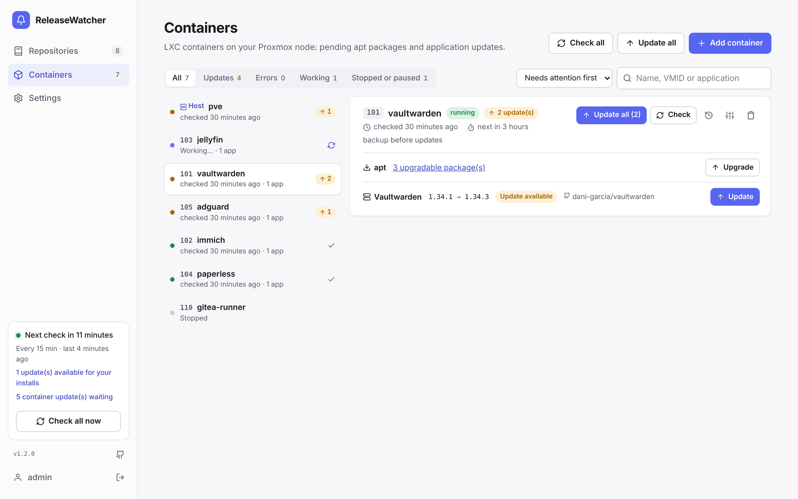

<div align="center">


# ReleaseWatcher

**Self-hosted release tracker for your homelab.**<br>
Get notified about new releases on GitHub, Gitea/Forgejo and GitLab and keep your Proxmox LXC containers up to date – from one small app.

[](https://github.com/Rozumek29/ReleaseWatcher/releases)
[](https://bun.sh)
[](https://angular.dev)
[](https://github.com/Rozumek29/ReleaseWatcher/wiki/Installation#docker)
[](https://github.com/Rozumek29/ReleaseWatcher/wiki/Machines)
[](https://github.com/Rozumek29/ReleaseWatcher/wiki)

[Features](#features) · [Quick start](#quick-start) · [Installation](#installation) ·
[**Documentation**](https://github.com/Rozumek29/ReleaseWatcher/wiki) · [Development](#development)

<br>

<picture>
  <source media="(prefers-color-scheme: dark)" srcset="docs/images/repositories-dark.png">
  
</picture>

</div>

---

## Features

**Releases**

- Watch any public or private repository on **GitHub**, **Gitea/Forgejo** (Codeberg, self-hosted) or **GitLab**
  (gitlab.com, self-managed); notifications on **Discord**, by **e-mail**, to **ntfy**, **Gotify**,
  **Telegram**, **Slack**, **Pushover** or any **webhook** – one message per release or one summary per check run.
- **Installed version** of your instance (read from a URL like `/api/version`, or entered by hand): see
  *Update available 1.34.1 → 1.34.3* at a glance and skip releases you already run.
- **Vulnerabilities** from GitHub security advisories and **OSV.dev**, matched against what you actually run.
- Custom icons (`sh:frigate` from [selfh.st/icons](https://selfh.st/icons/)); rate-limit friendly (ETags, optional token).

**Proxmox containers, VMs and servers**

- Pending **system packages** (apt, dnf/yum, zypper, apk, pacman), **Flatpak** / **Snap** apps and **application** versions of LXC containers,
  virtual machines (QEMU guest agent), the Proxmox node and plain Linux servers – over SSH, guests need no SSH server.
- One-click updates with live output, optional `vzdump` backup first, temporary CPU/RAM boost, *restart needed* hints.
  **Updates never run automatically.**
- **Home Assistant OS** VMs: Core, OS, Supervisor, apps and integrations.

**Docker and Podman**

- Containers on your machines and on Docker endpoints (socket proxy, socket, remote engine): installed version,
  *New image* when the registry digest changed, links to watched repositories. Read-only.

**App**

- One self-contained executable or a Docker image, one SQLite file, no external services.
- Password, **passkeys** and/or **single sign-on** (OpenID Connect: Pocket ID, Authentik, Keycloak…), **API tokens** for dashboards like Homepage, secrets encrypted at rest (AES-256-GCM).
- Light and dark themes with accent colours; every setting can be changed in the UI without a restart.
- **Backup & restore**: export the configuration as a JSON file (secrets left out) and import it with a preview, merging or replacing.

<table>
  <tr>
    <td width="50%">
      <picture>
        <source media="(prefers-color-scheme: dark)" srcset="docs/images/containers-dark.png">
        
      </picture>
      <p align="center"><sub>Machines – pending apt packages and application updates</sub></p>
    </td>
    <td width="50%">
      <picture>
        <source media="(prefers-color-scheme: dark)" srcset="docs/images/settings-dark.png">
        
      </picture>
      <p align="center"><sub>Settings – applied immediately, no restart</sub></p>
    </td>
  </tr>
</table>

## Quick start

```bash
docker run -d --name releasewatcher --restart unless-stopped \
  -p 8080:8080 -v releasewatcher-data:/data \
  ghcr.io/rozumek29/releasewatcher:latest

docker logs releasewatcher 2>&1 | grep setupCode    # one-time code to create your account
```

Open <http://localhost:8080>, create the account with the setup code and follow
[First steps](https://github.com/Rozumek29/ReleaseWatcher/wiki/First-steps).

## Installation

| Method | Best for | Guide |
| --- | --- | --- |
| Docker (`ghcr.io/rozumek29/releasewatcher`) | any Docker host, NAS | [Docker](https://github.com/Rozumek29/ReleaseWatcher/wiki/Installation#docker) |
| `bun run deploy -- --ct <vmid>` | a dedicated Proxmox LXC, installed from your computer | [Proxmox LXC](https://github.com/Rozumek29/ReleaseWatcher/wiki/Installation#proxmox-lxc-one-command) |
| `releasewatcher --install` | any Linux x64 / arm64 machine with systemd | [Native install](https://github.com/Rozumek29/ReleaseWatcher/wiki/Installation#native-install-systemd) |

Builds for x64 (AVX2), older x64 (`-baseline`) and 64-bit ARM. Updating:
[Updating ReleaseWatcher](https://github.com/Rozumek29/ReleaseWatcher/wiki/Updating-ReleaseWatcher).

> [!CAUTION]
> **The UI can run commands as root on your Proxmox node.** Keep it on a private network or behind HTTPS – see
> [Account and security](https://github.com/Rozumek29/ReleaseWatcher/wiki/Account-and-security).

## Documentation

Everything else lives in the **[wiki](https://github.com/Rozumek29/ReleaseWatcher/wiki)**:

| Topic | Pages |
| --- | --- |
| Getting started | [Installation](https://github.com/Rozumek29/ReleaseWatcher/wiki/Installation) · [First steps](https://github.com/Rozumek29/ReleaseWatcher/wiki/First-steps) · [Updating](https://github.com/Rozumek29/ReleaseWatcher/wiki/Updating-ReleaseWatcher) · [Configuration](https://github.com/Rozumek29/ReleaseWatcher/wiki/Configuration) (environment variables) |
| Releases | [Repositories](https://github.com/Rozumek29/ReleaseWatcher/wiki/Repositories) · [Vulnerabilities](https://github.com/Rozumek29/ReleaseWatcher/wiki/Vulnerabilities) · [Notifications](https://github.com/Rozumek29/ReleaseWatcher/wiki/Notifications) |
| Machines | [Connections and SSH](https://github.com/Rozumek29/ReleaseWatcher/wiki/Connections-and-SSH) · [Machines](https://github.com/Rozumek29/ReleaseWatcher/wiki/Machines) · [Applications and updates](https://github.com/Rozumek29/ReleaseWatcher/wiki/Applications-and-updates) · [Home Assistant OS](https://github.com/Rozumek29/ReleaseWatcher/wiki/Home-Assistant-OS) · [Docker containers](https://github.com/Rozumek29/ReleaseWatcher/wiki/Docker-containers) |
| App | [Account and security](https://github.com/Rozumek29/ReleaseWatcher/wiki/Account-and-security) · [API tokens](https://github.com/Rozumek29/ReleaseWatcher/wiki/API-tokens) · [Appearance](https://github.com/Rozumek29/ReleaseWatcher/wiki/Appearance) |
| Reference | [REST API](https://github.com/Rozumek29/ReleaseWatcher/wiki/REST-API) · [Troubleshooting](https://github.com/Rozumek29/ReleaseWatcher/wiki/Troubleshooting) · [FAQ](https://github.com/Rozumek29/ReleaseWatcher/wiki/FAQ) |

## Development

**Requirements:** [Bun](https://bun.sh) 1.4.4+ and Node.js 26 (the Angular CLI runs on Node; Bun is its package
manager).

```bash
bun install
bun run dev                 # API on :8080 (watch) + Angular dev server on http://localhost:4200
bun run typecheck && bun run test && bun run build    # same checks as CI
```

Contributor guides: [`AGENTS.md`](AGENTS.md) (workflow, conventions, secrets, checklists) and
[`DESIGN.md`](DESIGN.md) (architecture, API conventions, UI design system). Scripts, project layout and releases:
[Development](https://github.com/Rozumek29/ReleaseWatcher/wiki/Development).

## License

[MIT](LICENSE)
